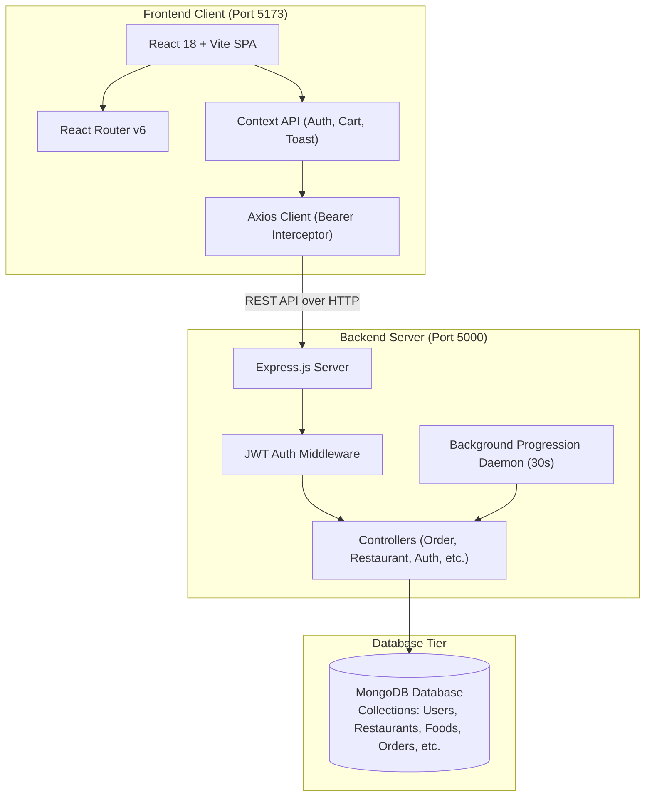
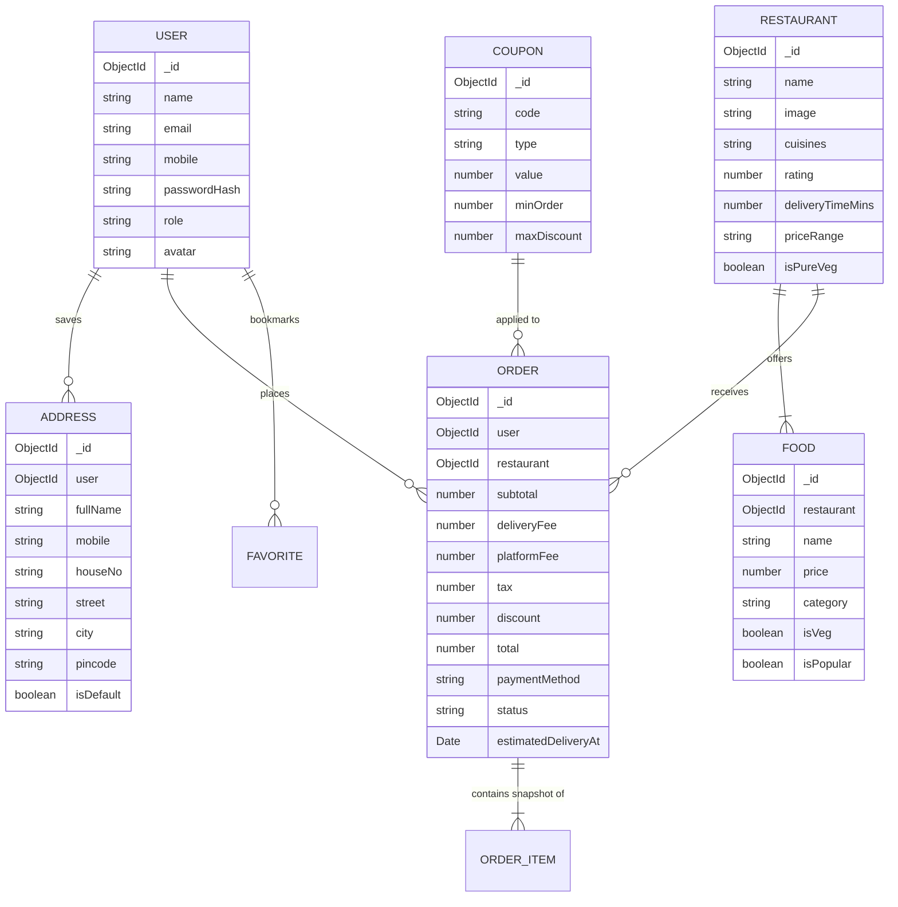
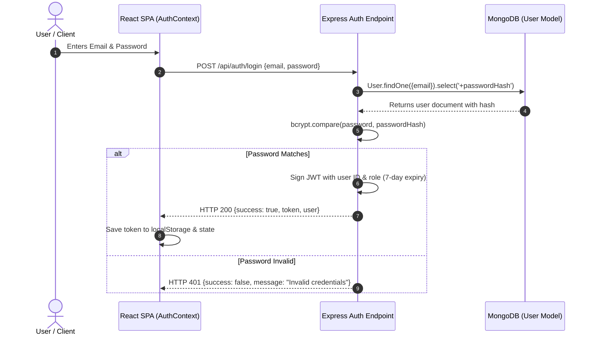
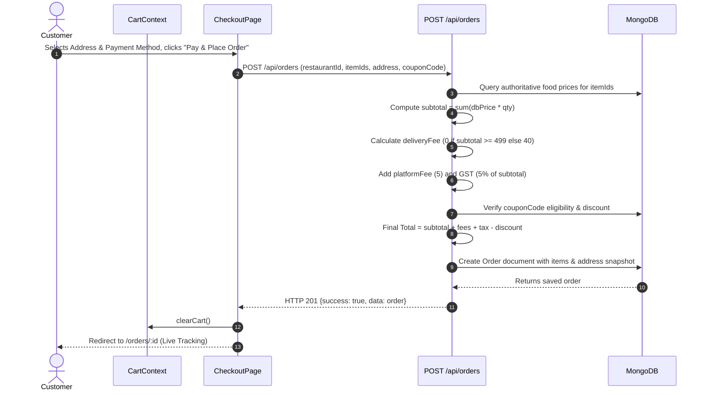

# 🎓 ALTS FOOD spot: Comprehensive Project & Viva Examination Guide

> **Project Title:** ALTS FOOD spot - Full-Stack MERN Food Delivery App  
> **Tagline:** *"Your cravings. Our mission."*  
> **Degree Program:** B.Tech / B.E. in Computer Science & Engineering / Information Technology  
> **Course:** Web Technologies / Full-Stack Development Mini Project

---

## 1. Project Explanation & Objectives

### 1.1 Problem Statement
In urban environments, hungry customers often face delayed meal deliveries, non-transparent delivery pricing, and complex user interfaces. Conversely, independent food businesses struggle to find lightweight, transparent digital platforms to showcase their menus. **ALTS FOOD spot** resolves these issues by offering a fast, responsive, transparent, and aesthetically appealing hyper-local food delivery platform.

### 1.2 Core Objectives
1. **Full-Stack MERN Architecture:** Build a decoupled application using React 18 on the frontend and Node.js/Express with MongoDB on the backend.
2. **Strict Server-Side Validation:** Recompute all pricing, fees, and promotional discounts on the server to prevent malicious client tampering.
3. **Single-Restaurant Cart Invariant:** Prevent logistical delivery conflicts by ensuring each order originates from a single restaurant kitchen.
4. **Live Order Progression Simulation:** Simulate the real-world lifecycle of food preparation and delivery via a background progression engine.
5. **Business Intelligence & Administration:** Offer restaurant owners and store administrators actionable revenue charts and catalog management tools.

---

## 2. Technology Stack & Justification

| Technology | Role | Why Chosen over Alternatives? |
| :--- | :--- | :--- |
| **React 18 (Vite)** | Frontend Framework | Fast Virtual DOM reconciliation, modular component hierarchy, and instant Vite hot-module replacement (HMR) compared to slower Webpack bundlers. |
| **React Context API** | State Management | Lightweight and built natively into React; eliminates bulky external Redux/MobX boilerplate for small-to-mid size projects (`AuthContext`, `CartContext`, `ToastContext`). |
| **Node.js & Express.js** | Backend Runtime & Framework | Non-blocking, event-driven asynchronous I/O model ideal for concurrent API requests and polling operations. |
| **MongoDB & Mongoose** | NoSQL Database & ODM | Schema flexibility for storing hierarchical snapshots of food items and delivery addresses inside orders without complex SQL joins. |
| **JWT (JSON Web Tokens)** | Stateless Auth | Eliminates server-side session memory consumption; token payload carries user ID and role with cryptographic signature. |
| **Vanilla CSS (Design Tokens)** | Styling System | Full design flexibility using native CSS custom properties without Tailwind build bloat or UI kit lock-in. |
| **Recharts** | Analytics Charts | Declarative React charting library built on SVG for crisp, responsive administrative visualizations. |

---

## 3. System Architecture Diagram

---

## 4. Entity-Relationship (ER) & Data Model Diagram

---

## 5. Key Request & Logic Flows

### 5.1 Authentication Flow

### 5.2 Order Placement & Server-Side Pricing Verification Flow

---

## 6. Top Viva Questions & Answers

### Q1: Why did you choose MERN instead of PHP/MySQL or Django?
**Answer:** The MERN stack uses a unified language (JavaScript) across the frontend and backend. Node.js provides high throughput through asynchronous, non-blocking I/O. MongoDB's JSON-like document format maps directly to JavaScript objects, allowing us to store complete address and food snapshots within orders without multi-table SQL join overhead.

### Q2: Why do you calculate the order total on the backend instead of accepting the client's total?
**Answer:** The client side can be easily tampered with using browser developer tools or HTTP clients like Postman. If we trusted client totals, a malicious actor could edit the price of a ₹400 biryani to ₹1. The backend always queries the database for authoritative unit prices, applies verified business rules, and computes the canonical total before storing the order.

### Q3: How is authentication handled securely?
**Answer:**
1. Passwords are never stored in plain text; they are hashed using **`bcryptjs`** with 10 salt rounds before database insertion.
2. The user model explicitly sets `select: false` on `passwordHash` so it is not returned in standard queries.
3. Upon login, a cryptographically signed **JWT (JSON Web Token)** is issued. Protected routes inspect the token in the `Authorization: Bearer <token>` header using middleware before fulfilling the request.

### Q4: How does the single-restaurant cart rule work?
**Answer:** In `CartContext`, before an item is added, the code checks whether `cartState.restaurant` is already set. If it belongs to a different restaurant ID and the cart is non-empty, a conflict dialog is shown asking the user whether to discard the current cart and start a new order.

### Q5: How is live order tracking implemented?
**Answer:** The tracking page (`OrderDetailPage.jsx`) mounts an interval that polls `GET /api/orders/:id` every 10 seconds. Meanwhile, the backend runs a lightweight scheduler (`setInterval`) that checks active demo orders and auto-advances their status from `Placed` $\to$ `Accepted` $\to$ `Preparing` $\to$ `Out for Delivery` $\to$ `Delivered` every 30 seconds. Administrators can also manually override the status at any time.

### Q6: What is an address snapshot and why is it used?
**Answer:** Instead of only saving a reference to the user's address ID, the order stores a frozen **snapshot** of the address at the moment of checkout. If the user later edits or deletes their address in their profile, historical delivery records remain accurate and unchanged.

### Q7: What are the HTTP status codes used in your REST API?
**Answer:**
- `200 OK`: Request succeeded (e.g. data retrieved).
- `201 Created`: Resource successfully created (e.g. registration, order created).
- `400 Bad Request`: Validation failure or invalid parameters.
- `401 Unauthorized`: Missing or expired authentication token.
- `403 Forbidden`: Insufficient permissions (e.g. regular user accessing admin routes).
- `404 Not Found`: Requested restaurant, dish, or order does not exist.
- `500 Internal Server Error`: Unhandled server exception.

---

## 7. Limitations & Scope for Future Enhancements

### Current Limitations
1. **Simulated Payments:** Transactions are currently simulated rather than integrated with a live banking merchant gateway (Razorpay / Stripe).
2. **Polling vs WebSockets:** Order updates use 10-second polling rather than bidirectional WebSockets (Socket.IO).
3. **Mock Map Coordinates:** Real-time driver GPS tracking on a map is represented as status stages rather than live geospatial coordinates.

### Future Enhancements Roadmap
1. **Live Payment Gateway:** Integration with Razorpay / Stripe Webhooks for instant UPI QR and card payments.
2. **WebSocket Live Tracking:** Real-time push updates via Socket.IO for sub-second status changes and rider location tracking.
3. **Live GPS Map Tracking:** Integration with Google Maps API or Leaflet.js to display moving delivery rider markers.
4. **Multi-Role Portals:** Separate mobile apps / portals for Delivery Partners (accept/reject deliveries) and Restaurant Kitchens (KDS - Kitchen Display System).
5. **AI Recommendation Engine:** Personalized dish recommendations based on past order history and collaborative filtering.
6. **Customer Ratings & Photo Reviews:** Permitting customers to post verified star ratings and food photos after delivery.
